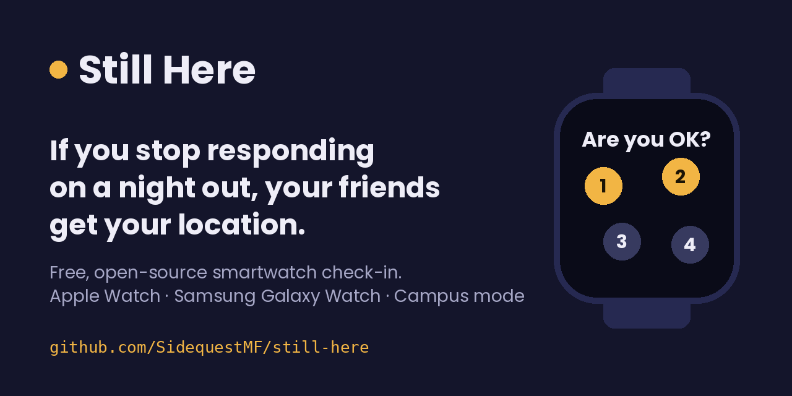

# Still Here

**An open-source smartwatch safety app for nights out, for Apple Watch and for Samsung Galaxy Watch and other Wear OS watches.** It checks on you, and if you stop responding normally, it texts the people you chose with your location.

Drink spiking is hard to detect. Test strips miss many drugs, and the most common substance in drug-facilitated assault is plain alcohol. Still Here doesn't test the drink. It watches for the *effect*, whatever the cause:

- your heart rate drifting far from your own normal,
- a stumble or fall where you stay down,
- long unusual stillness, or the watch coming off,
- or simply a missed scheduled check-in.

When something looks wrong, the watch buzzes and asks **"Are you OK?"** with a 5-second tap test (tap 1, 2, 3, 4 in order), compared against your own speed from earlier in the night. Pass it and nothing happens. Fail it twice, or don't answer, and your trusted contacts get a text with your location.

## Why this exists, and who wrote it

**All of the code here was written by Claude, an AI made by Anthropic.** The person who started this project, [SidequestMF](https://github.com/SidequestMF), is not a programmer. They wanted something like this to exist and be used everywhere, by anyone going out, on any watch. So they had an AI build a starting point and are giving it away.

Please treat it as a stepping stone. If you know watch development, health sensing, or how to support survivors, you can do better than this. Take it, fix it, fork it, build the real thing. That's the whole point.

> **Status: prototype.** The decision logic is tested in simulation; neither watch app has **been built or run on a real watch yet.** Please don't rely on it for safety yet. See [What's tested](docs/TESTING.md).

## Campus mode

Students can set up campus mode once, for any school:

- **Campus police number in every alert**, so friends know who can reach a dorm fastest.
- **A safe-ride offer** when a check-in is passed but shaky (slower than usual, a wrong tap, or a second try).
- **Next-morning advice** after any alert: get to an ER soon, ask for a drug screen by name, plus the school's confidential support line.

Harvard, MIT, and Yale are pre-filled from each school's own website. [Add your school](campuses/README.md) in a few minutes.

## Try it now (no watch needed)

**[Open the demo on your phone →](https://sidequestmf.github.io/still-here/)** It walks through the whole flow, including campus mode, with simulated sensors. Nothing is sent. (Source: [web-prototype/index.html](web-prototype/index.html).)

## What's in this repository

| Folder | What it is |
| --- | --- |
| `web-prototype/` | Single-page demo of the check-in and alert flow |
| `apple/` | Swift source for the Apple Watch app and its iPhone companion, plus the shared detection logic and its unit tests |
| `android/` | Kotlin source for Samsung Galaxy Watch and other Wear OS watches, and the Android phone companion |
| `campuses/` | Starter list of campus numbers for campus mode, with sources |
| `relay/` | Tiny Node.js service that sends the alert texts (iPhone apps can't text silently) |
| `tests/` | Simulated-night tests of the detection logic and browser tests of the prototype |
| `docs/` | Safety limits, test results, and open research questions |

## How you can help

- **iOS / watchOS developers:** build the app on a real watch and report what breaks. See [apple/README.md](apple/README.md).
- **Android / Wear OS developers:** the same for Galaxy Watch and Pixel Watch. See [android/README.md](android/README.md).
- **Researchers:** the detection thresholds are educated guesses. Real-world data (with ethics review) is the most valuable contribution. See [docs/RESEARCH.md](docs/RESEARCH.md).
- **Survivors, advocates, campus safety teams, bar staff:** tell us what would actually be used on a night out, and what would make it worse. Open an issue.
- **Students:** [add your campus](https://github.com/SidequestMF/still-here/issues/new?template=add-campus.yml), or [report a wrong number](https://github.com/SidequestMF/still-here/issues/new?template=wrong-number.yml).

New here? See [CONTRIBUTING.md](CONTRIBUTING.md) and the [good first issues](https://github.com/SidequestMF/still-here/labels/good%20first%20issue).

## Important limits

Still Here is not a medical device and cannot tell whether a drink was spiked. It can miss things and it can raise false alarms. It is one layer, alongside drink covers, staying with friends, and venues that take this seriously. In an emergency, call 911. Full details: [docs/SAFETY.md](docs/SAFETY.md).

## License

MIT. See [LICENSE](LICENSE).
